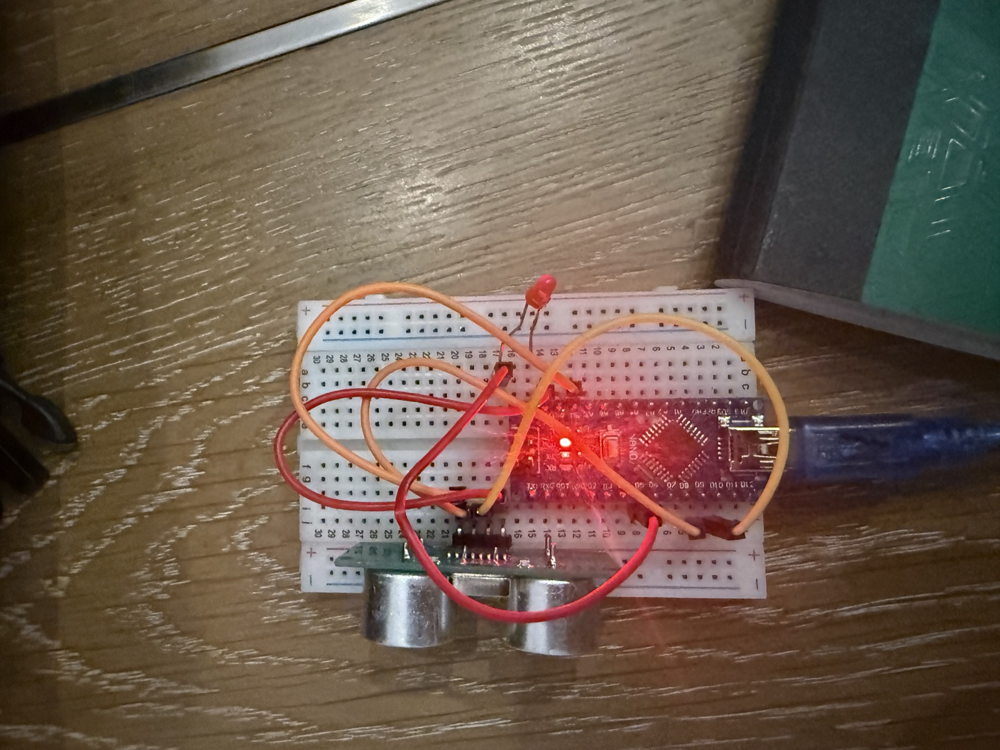
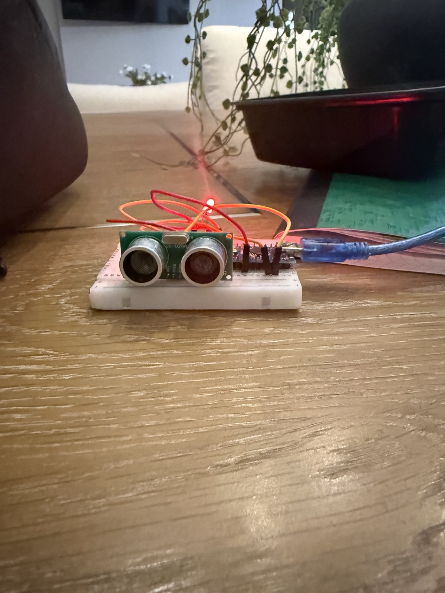

# The Doorman

## Charter

**It notices:** how close an object is to the HC-SR04 sensor.

**It calls you:** Near, Far or Nobody.

**It does:** hold a steady red light for Near, blink slowly for Far, and go dark for Nobody.

### For them

- **Near:** a steady red light marks the close boundary.
- **Far:** a slow blink marks the outer distance band.
- **Nobody:** the light goes dark after the room has stayed empty.

### To them

- **Near:** Danny's name makes closeness visible.
- **Far:** Alexander's name turns distance into a slower signal.
- **Nobody:** the group's name for absence is silence, not a stored identity.

**It refuses:** to identify a face, remember a visitor, or count visits. The word is a label made from distance alone, not a fact about the person.

## State Table

The Nano runs these rows from the HC-SR04 reading in centimeters. `GAP` is hysteresis: an inactive row must cross the far edge of the gap to start; the current row remains true through the gap. A candidate must keep winning for its full hold before the name changes.

| Name | Owner | Distance rule (`LINE`) | `GAP` | Hold | Nano response |
|---|---|---|---:|---:|---|
| Near | Danny Girdish | Under 30 cm; enters below 25 cm and holds through 35 cm | 5 cm | 1 s | Steady red LED |
| Far | Alexander Bay Baltierrez | 30-100 cm; LINEs at 30 and 100 cm | 5 cm at each edge | 1 s | Red LED blinks slowly |
| Nobody | Group | Over 100 cm; enters above 105 cm and holds from 95 cm up | 5 cm | 5 s | LED off |

On startup, the Nano begins with no assigned name; it waits for the matching row's hold. Far enters above 35 cm and through 105 cm when coming from Near, or from 25 cm to below 95 cm when coming from Nobody; it stays active from 25-105 cm. A missing echo reads as 400 cm. If the LED flickers at an edge, increase `GAP` in `bench/names-distance/names-distance.ino`.

The optional browser bench uses the same three names and holds, but its own smoothed readings. It is not needed for the physical piece.

## Wiring and build

The prototype uses one sensor only. The Nano reads the sensor and runs every name itself; the laptop is not part of the final interaction.

| Part | Connection |
|---|---|
| HC-SR04 VCC | Nano 5V |
| HC-SR04 GND | Nano GND |
| HC-SR04 TRIG | Nano D9 |
| HC-SR04 ECHO | Nano D10 |
| Red LED long leg | Nano D5 |
| Red LED short leg | 220 ohm resistor, then GND |

Print [`bench/state-legend.svg`](bench/state-legend.svg) and place it beside the LED so visitors can read the name each light pattern means. The wall label is separate; print [`LABEL.md`](LABEL.md), sign and date it in class, and place it face down beside the piece.

## How to run it

1. Wire the HC-SR04 and LED as shown above, then upload `bench/names-distance/names-distance.ino` to the Nano in the Arduino IDE.
2. For a one-time check, open Serial Monitor at 115200 baud and look for lines such as `cm 23.6 name near`; close Serial Monitor afterward.
3. Power the Nano from a power bank or USB wall charger; it starts on plug-in and runs all three names without a laptop.

## Break log

- **Nov 12, PR #11 / Issue #6:** The Nobody response needed to explicitly leave the LED off. The sketch now sets the LED low for that row.
- **Nov 16, PR #12:** The Arduino IDE needs a sketch folder, not the PlatformIO `src/main.cpp` file. The run instructions now point to the standalone `.ino`.
- **Nov 16:** The browser and Serial Monitor cannot share the Nano's serial port. Close Serial Monitor before connecting the optional browser bench.

## Credits

- **Danny Girdish:** owns the Near row and its steady-light response.
- **Alexander Bay Baltierrez:** owns the Far row and its slow-blink response.
- **Both members:** own the Nobody row and the shared Nano, sensor, wiring, and enclosure.
- **Sensor:** one HC-SR04 ultrasonic distance sensor.
- **Materials:** Arduino Nano, breadboard, jumper wires, red LED, 220 ohm resistor, USB power bank or USB wall charger.
- **Year:** 2026.
