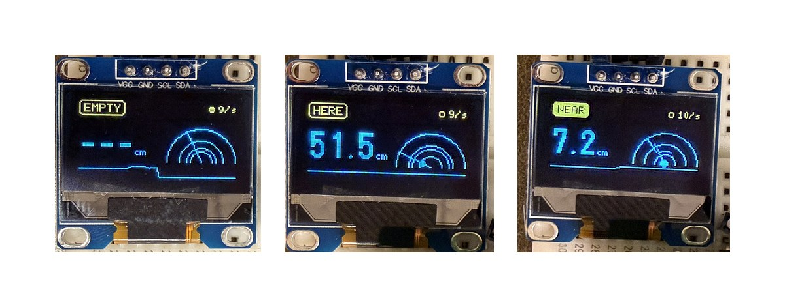

# The bench track

An Arduino Nano and two sensors in place of the camera. The bench swaps the sensor and nothing else: `piece.js` and `fake-sense.js` stay exactly as they are, and your State Table works the same way. Bench pairs open `bench.html` instead of `index.html`, and write their rows in `bench/table-bench.js` instead of `table.js`. The steps are in the main README, under **Bench pairs**.

**Simple sensor first.** Every pair builds with sensors from the shelf below, the simple tier, and gets them working in the browser before anything else. An advanced sensor is a second sensor, added after the simple one works, never instead of it.

## Building it

The kits come apart, so building the circuit is part of your work.

Important: in the Arduino IDE, each sketch must live in its own folder. Open the folder that matches the sketch you want to upload, such as `bench/bench/` for the simple distance sensor, then click **Upload**. Do not try to upload `src/main.cpp` from this repo in the Arduino IDE; that file is only for PlatformIO.

1. A Nano, a breadboard and jumpers from the north racks in the Innovation Commons. If the Nano's header pins aren't soldered yet, that comes first. Ask Mr. Reasy before you heat an iron.
2. Two sensors on the one Nano, one per partner. Wire each one and check it in the Arduino IDE's Serial Monitor at 115200 before the browser sees it.
3. Add your sensor's number to the line `bench.ino` prints (`Serial.print(" light "); Serial.print(analogRead(A0));`), then its function in `SIGNALS` in `sense-serial.js`, then its name in `bench/table-bench.js`.

## The reference build

This one works, end to end: a Nano and an HC-SR04 run the Near, Far, and Nobody states on the Arduino, with an optional OLED screen and LED response. Build yours to match first, then change it.

| Part | Pin | Nano pin |
|---|---|---|
| HC-SR04 | VCC | 5V |
| HC-SR04 | GND | GND |
| HC-SR04 | TRIG | D9 |
| HC-SR04 | ECHO | D10 |
| OLED (optional) | VCC | 5V |
| OLED (optional) | GND | GND |
| OLED (optional) | SDA | A4 |
| OLED (optional) | SCL | A5 |
| LED | Long leg (anode) | D5; short leg (cathode) through a 220 ohm resistor to GND |

*The Nano's pins: D9 and D10 on the right go to the sensor; A4, A5, 5V and GND on the left.*

*Ours is a US-025A, a clone of the HC-SR04. Same four pins in the same order (VCC, Trig, Echo, GND), same wiring, same sketch. Either board works.*

Flash `bench/names-distance/names-distance.ino` for the state-table build with LED responses. To run the OLED and LED together, upload `bench/oled_and_led_distancedemo/oled_and_led_distancedemo.ino` instead. Near enters below 30 cm, Far covers the middle band through 100 cm, and Nobody enters above 100 cm. Near and Far hold for 1 second; Nobody holds for 5 seconds. Only one sketch runs on the Nano at a time. To use the optional browser readout, flash `bench/bench/bench.ino` instead, open `bench.html` on localhost in Chrome, connect the Arduino, and press **D**.

### Standalone Arduino examples

The `distance-led` folder is an earlier one-state LED example. `names-distance` runs the Near, Far, and Nobody states and their LED responses. Open each folder's `.ino` file as its own sketch in the Arduino IDE. Keep the sketches in separate folders: Arduino compiles `.ino` files together when they are in the same sketch folder.

**The lag is the table, not the wire.** Near and Far each hold for 1 second; Nobody holds for 5 seconds. The 5 cm gap around each boundary prevents flicker as readings wobble near a line.

**If the upload fails** with `not in sync` or `programmer is not responding`, the Nano has the old bootloader, which is common on clone boards. In the Arduino IDE choose **Tools → Processor → ATmega328P (Old Bootloader)** and upload again (in `arduino-cli`, the board is `arduino:avr:nano:cpu=atmega328old`). After a failed upload, unplug the Nano and plug it back in before the next try, because the port can stay stuck.

### The screen (optional)

`bench/oled_and_led_distancedemo/oled_and_led_distancedemo.ino` runs the same Near, Far, and Nobody distance bands and holds as `names-distance.ino`, and drives both the D5 LED and the OLED: Near is steady, Far blinks every 500 ms, and Nobody is off. The OLED shows the state badge, distance, sonar sweep, and reading history on a 0.96 in SSD1306 screen (128 x 64, I2C). The LED on D5 does not conflict with the OLED's I2C pins A4/A5 or the sensor pins D9/D10. The sketch continues to print `cm` readings over USB for `bench.html`. On two-colour screens the top strip is yellow and holds the current state.

**If compiling says `U8g2lib.h: No such file or directory`:** install the **U8g2** library by **olikraus** in Arduino IDE's Library Manager (Sketch → Include Library → Manage Libraries, then search for `U8g2`). Install **U8g2**, not the older **U8glib** library, then compile again.

*The screen shows Near below 30 cm, Far in the middle band, and Nobody beyond 100 cm; each state changes only after its hold time. The display also shows the live distance, sonar sweep, and reading history.*

## What's on the shelf

| Sensor | A signal it can give | Watch for |
|---|---|---|
| HC-SR04 ultrasonic | `near`, `present` | The worked example in `bench.ino`. It reports the nearest thing in a cone about 30° wide, so flat on a desk it hears the desk: aim it up or off the edge. Soft clothing swallows the echo. |
| PIR motion | `moving` | On or off, and it holds itself on for a few seconds. Someone standing still disappears. |
| Photoresistor | `shade` | Needs a 10k resistor beside it. The room's light changes through the day. |
| TCRT5000 reflective IR | `close` | A hand within a few centimetres, nothing further. |
| Sound sensor (KY-037/038) | `loud` | Read its analog pin (A0), which gives a level. The digital pin only says over or under its dial. |
| TTP223 touch pad | `touch` | Works through a few millimetres of paper or plastic. |
| Piezo disc | `knock` | It spikes for an instant on a tap, so give its state a hold. |
| Tilt switch | `tilted` | For a piece someone picks up. |

Every sensor here prints a number; the meaning is yours. A `near` of 0.9 is a distance, never a feeling.

## Advanced sensing

Mr. Reasy's own bench sensors, lent to pairs whose simple sensor already works in the browser. Ask him for one; they live on his bench, not the shelf. Several need a 3.3 V board with more memory than the Nano: the Nano 33 IoT (north racks, a few) or an ESP32-S3 from his bench.

| Sensor | A signal it can give | How it talks | Board | Difficulty |
|---|---|---|---|---|
| MPR121 capacitive touch (12 pads) | `touched`, and which pad | I2C | Nano | Moderate. Any conductive thing becomes a pad: foil, fruit, graphite. |
| RC522 RFID reader | `tagged`, and which card | SPI | Nano, 3.3 V power only | Moderate. Each card has its own ID, so a piece can know which object is on it. |
| AS7341 / AS7343 spectral sensor | `colour`, `bright` | I2C | Nano | Moderate. Eight to fourteen colour bands; it needs steady light on the object. |
| BNO080/085 IMU | `tilted`, `turning`, `still` | I2C | Nano 33 IoT or ESP32-S3 | Hard. Gives orientation directly; too big for the Nano's memory. |
| INMP441 microphone | `loud` | I2S | Nano 33 IoT or ESP32-S3 | Hard. A real digital microphone; the Nano has no I2S. |
| HLK-LD2450 radar | `near`, `present`, `count`, where people stand | UART at 256000 baud | Nano 33 IoT | Hard. Tracks up to three people by position, through thin walls and in the dark. |
| Load cell, 10 kg or 15 kg bar | `loaded`, `weight` | Needs an amplifier board (HX711 or NAU7802) | Nano | Moderate once the amplifier is in hand. Ask Mr. Reasy whether one is free before you plan on it. |

Same rule as the shelf: the sensor gives a number and your State Table gives it a meaning. A radar `count` of 2 is two bodies in range, not a crowd that wants anything.
